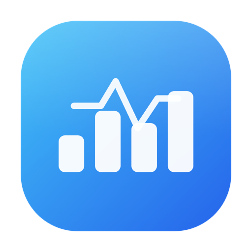
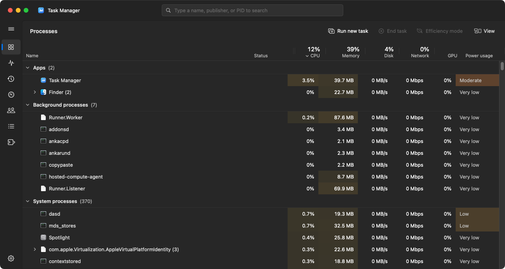
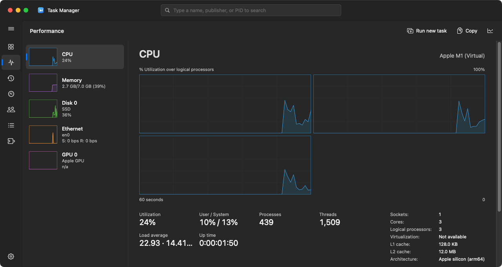
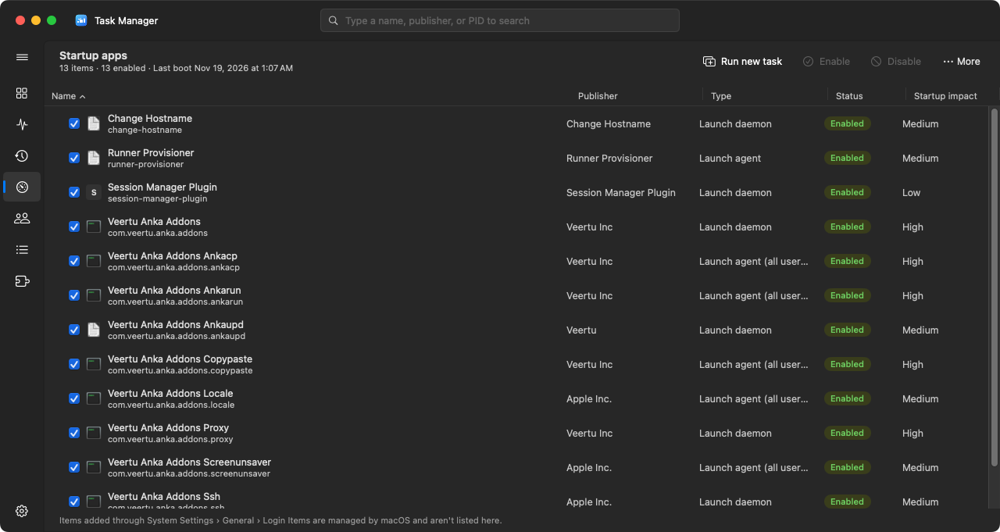
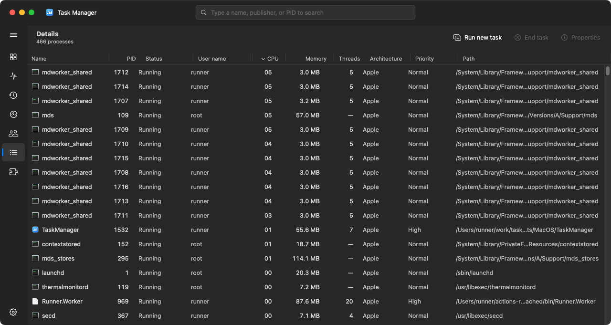
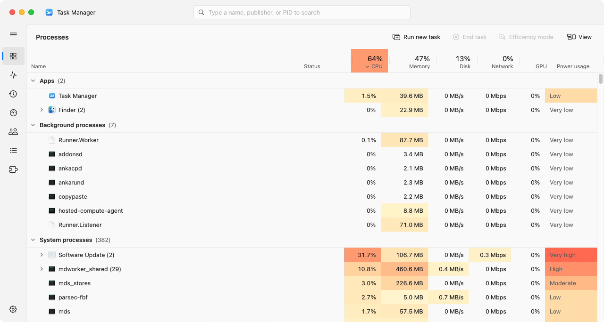

<div align="center">



# Task Manager for macOS

The Windows 11 Task Manager, rebuilt as a native Mac app in Swift.

[](https://github.com/kevineduardo/task-manager-macos/actions/workflows/ci.yml)


[](LICENSE)

</div>

<p align="center">
  
</p>

Activity Monitor is fine, but if you spent years pressing Ctrl+Shift+Esc you
already know where everything lives in Task Manager. This app puts it in the same
place on a Mac: a navigation rail on the left, a search box in the title bar,
processes grouped by app, heat-shaded columns, and a Performance page with a graph
for each device.

It is a rewrite of [Task Manager for macOS](https://github.com/tnAnGel/Task-Manager-for-macOS)
by tnAnGel, which is built with Electron. This version keeps the layout and the
features, drops Electron and Node, and reads system data straight from the kernel,
so it stays near the bottom of its own CPU column.

## Features

**Processes**
- Grouped like Windows 11: *Apps*, *Background processes* and *System processes*.
  An app collects its helpers (same bundle, the app's XPC services, and things it
  launched), so Chrome's renderers or the shells in your terminal sit under their app.
- CPU, Memory, Disk, Network, GPU and Power usage columns, shaded from pale yellow
  to orange as usage grows. Sort by any column, drag to resize, right-click the
  header to add PID, Process name, User name, Architecture (Apple or Intel/Rosetta)
  and Threads.
- Per-process **disk** I/O and, on Apple silicon, per-process **GPU** usage.
- Right-click: End task, End process tree, Force quit, Efficiency mode,
  Suspend/Resume, Set priority, Open file location, Search online, Copy, Go to
  details, Properties.
- Keyboard: arrows to move, ←/→ to collapse and expand, Delete to end a task,
  Return for properties, and typing anywhere starts a search.

**Performance**
- 60-second graphs for CPU, memory, each physical disk, each connected network
  adapter and each GPU.
- CPU shows one graph per logical processor or one overall graph (right-click the
  graph to switch), plus P/E cores, caches, load average and up time.
- Memory uses the same model as Activity Monitor (app + wired + compressed) and
  shows a composition bar, swap and memory pressure.
- Disks show active time and transfer rate. Network shows send and receive
  throughput, link speed and addresses. Apple GPUs also show renderer and tiler load.

**App history**: CPU time, network and disk traffic per app. It keeps counting
across launches and can be cleared.

**Startup apps**: every launch agent and daemon with a readable name, the publisher
taken from its code signature, the vendor's icon, and a checkbox to enable or
disable it. Items from the same vendor (Adobe, Google, Microsoft…) fold into one row.

**Users, Details, Services**: processes by user, a flat Details list with
priority, threads and paths, and every launchd service for your session and the
system, with Start, Stop and Restart.

**Settings**: light, dark or system theme, default start page, update speed
(high, normal, low, paused), always on top, minimize on use, and an optional CPU
graph in the menu bar.

## Screenshots

| Performance | Startup apps |
| :---: | :---: |
|  |  |
| **Details** | **Light theme** |
|  |  |

The CI renders these screenshots on every build, so they always match the code.

## Install

1. Download the latest `.dmg` from [Releases](https://github.com/kevineduardo/task-manager-macos/releases).
   One universal build runs natively on Apple silicon and on Intel Macs.
2. Drag **Task Manager** to Applications.
3. The app is signed ad hoc, not notarized. The first time, right-click it and pick
   **Open**, or run:

   ```bash
   xattr -dr com.apple.quarantine "/Applications/Task Manager.app"
   ```

Requires macOS 13 Ventura or later.

## Build from source

You need Xcode 15 or later (or the matching command line tools).

```bash
git clone https://github.com/kevineduardo/task-manager-macos.git
cd task-manager-macos
swift run TaskManager            # debug run
swift test                       # unit tests
scripts/build-app.sh             # universal .app, .zip and .dmg in dist/
ARCHS=arm64 scripts/build-app.sh # one architecture only
```

`TaskManager --screenshots <dir> [--theme light]` renders every page to PNG and
quits. CI uses it to produce the images above.

## How it gets its numbers

| Metric | Source |
| --- | --- |
| CPU per core | `host_processor_info` tick counters |
| Memory | `host_statistics64` (`vm_statistics64`), `vm.swapusage`, `kern.memorystatus_vm_pressure_level` |
| Process list, CPU time, footprint, disk I/O, energy | `libproc`: `proc_listallpids`, `proc_pidinfo`, `proc_pid_rusage` |
| Processes owned by other users | `/bin/ps` (setuid on macOS), one batched call per refresh |
| Disk throughput and active time | IOKit `IOBlockStorageDriver` statistics |
| Network throughput | 64-bit interface counters from `sysctl(NET_RT_IFLIST2)` |
| Per-process network | `nettop`, only while a page shows it |
| GPU and per-process GPU | IOKit `IOAccelerator` performance statistics and user clients |
| Startup items | `~/Library/LaunchAgents`, `/Library/LaunchAgents`, `/Library/LaunchDaemons`, `launchctl print-disabled` |
| Services | `launchctl list` and `launchctl print system` |

Work that the current page doesn't show is skipped, and sampling slows to every
5 seconds while the window is hidden.

## Limitations

macOS draws some lines that Windows doesn't:

- For processes owned by other users (mostly root), the kernel only shares CPU time
  and resident memory with a normal user. Disk, threads and energy for those show "—".
- Ending, suspending or reprioritizing other users' processes, and changing launch
  daemons, opens the standard administrator prompt.
- Efficiency mode uses the Darwin background policy. It works for your own processes.
- Per-process GPU needs an Apple GPU. Intel Macs show the total only.
- "Startup impact" is an estimate from each job's `RunAtLoad`/`KeepAlive` keys.
  macOS doesn't measure it.
- Login Items added in System Settings are managed by macOS and aren't listed. The
  Startup apps page links to that settings pane.
- Power usage comes from the energy the kernel bills to each process when it's
  available, and from CPU share otherwise.

## Project layout

```
Sources/TaskManager/
  App/          app delegate, window and toolbar, menus, menu bar extra, screenshot mode
  Sampling/     CPU, memory, disk, network, GPU and process samplers
  Model/        snapshots, grouping, sorting, history, preferences, formatting
  System/       process actions, startup items, launchd services
  UI/           theme, shared components, one file per page, dialogs
Tests/          unit tests (formatting, parsers, grouping, samplers)
scripts/        build-app.sh
```

## Contributing

Issues and pull requests are welcome. Please run `swift test` before opening a PR,
keep the Windows 11 layout as the reference for UI changes, and say in the PR if an
AI model wrote part of the change and which one.

## Credits

- Original app, layout and feature set: [tnAnGel/Task-Manager-for-macOS](https://github.com/tnAnGel/Task-Manager-for-macOS)
  (MIT). The app icon and the launchd label dictionary come from that project.
- Written with help from Claude (Anthropic).

## License

[MIT](LICENSE).
